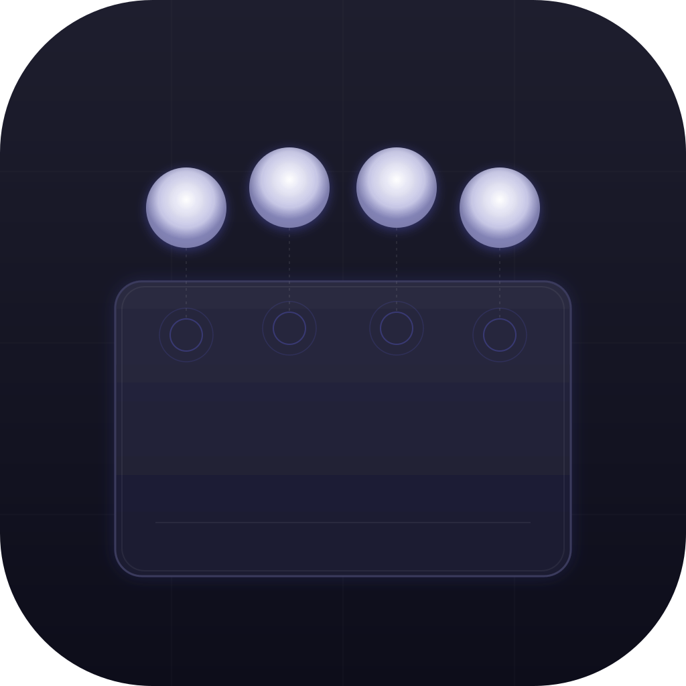
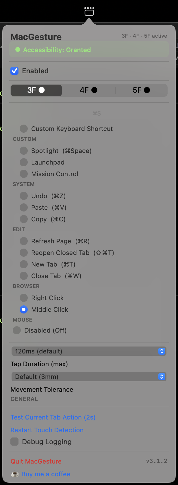

#  Mac Gesture

**Custom multi-finger trackpad gestures for macOS.**


---

## ⬇️ Download

**[Download Latest Release (DMG)](https://github.com/is-harshul/mac-gesture/releases/latest)**

### First-time setup after download:

1. Open the DMG → drag **MacGesture.app** into **Applications**
2. **Remove the quarantine flag** (required because the app is not notarized):
   ```bash
   xattr -cr /Applications/MacGesture.app
   ```
3. Open MacGesture → grant **Accessibility** permission when prompted
4. Tap your trackpad!

> Without the `xattr` step, macOS will show "the app is damaged" — this is normal for unsigned apps downloaded from the internet. You only need to do this once per version.

---

## What It Does

Mac Gesture maps **3-finger, 4-finger, and 5-finger trackpad taps** to configurable actions — each independently. Tap with 4 fingers to middle-click a link, 3 fingers to copy, 5 fingers to launch Spotlight. Or bind **any keyboard shortcut** you want: ⌘⇧S, ⌥F4, or whatever your apps support. Each gesture can use its own custom shortcut.

All your existing swipe, pinch, and drag gestures continue working — Mac Gesture only triggers on quick taps, not holds or swipes.

### Default Configuration

| Gesture | Default Action | Customizable? |
|---|---|---|
| **3-finger tap** | Middle Click | ✅ Yes |
| **4-finger tap** | Off | ✅ Yes |
| **5-finger tap** | Off | ✅ Yes |

### Available Actions

Each gesture can be mapped to any of these:

| Category | Actions |
|---|---|
| **Mouse** | Middle Click · Right Click |
| **Browser** | Close Tab `⌘W` · New Tab `⌘T` · Reopen Closed Tab `⇧⌘T` · Refresh `⌘R` |
| **Edit** | Copy `⌘C` · Paste `⌘V` · Undo `⌘Z` |
| **System** | Mission Control · Launchpad · Spotlight `⌘Space` |
| **Custom** | **Keyboard Shortcut** — bind any key combo (⌘⇧S, ⌥F4, etc.) to 3, 4, or 5 finger taps |
| **Off** | Disabled (gesture passes through to macOS) |

### Tap vs Swipe Detection

Mac Gesture distinguishes taps from swipes/pinches using two filters:

| Check | What it does | Default |
|---|---|---|
| **Duration** | Rejects anything held too long | ≤ 120ms |
| **Movement** | Rejects if fingers drift | ≤ 3mm |

Real taps are 30–100ms with almost no movement. Swipes are 200ms+. The combination catches all taps and rejects everything else.

| Gesture | Result |
|---|---|
| Quick 3/4/5-finger tap | ✅ Fires the configured action |
| Multi-finger swipe | ❌ Ignored — passes through to macOS |
| Multi-finger pinch | ❌ Ignored — passes through to macOS |
| Long press | ❌ Ignored (exceeds tap duration) |

---

## Installation

### Download (Recommended)

Grab the DMG from the [latest release](https://github.com/is-harshul/mac-gesture/releases/latest), open it, and drag to Applications.

### Build from Source

```bash
git clone https://github.com/is-harshul/mac-gesture.git
cd mac-gesture
chmod +x build.sh
./build.sh
./test.sh   # optional: run the pure-logic tests
cp -r build/MacGesture.app /Applications/
open /Applications/MacGesture.app
```

**Requirements:** macOS 12+, Xcode Command Line Tools (`xcode-select --install`). Optional: `brew install librsvg` for icon generation.

### Accessibility Permission

On first launch, grant Accessibility access:

**System Settings → Privacy & Security → Accessibility → toggle MacGesture ON**

> Mac Gesture uses `CGEvent` to simulate mouse/keyboard events. It has zero network access and never collects any data.

### Open at Login

**Enabled by default (macOS 13.0+)**. MacGesture automatically registers itself to launch at login on first run. You can toggle this in the menu bar settings.

For manual setup on older systems:

`System Settings → General → Login Items → + → MacGesture`

---

## Configuration

Click the trackpad icon in the menu bar. You'll see three independently configurable gesture sections:



```
┌─────────────────────────────┐
│ MacGesture                  │
│   3F → Middle Click         │
│   4F → Off                  │
│   5F → Off                  │
├─────────────────────────────┤
│ ☑ Enabled                   │
├─────────────────────────────┤
│ 3-FINGER TAP  Off           │
│   Disabled (Off)       ●    │
│   Mouse                     │
│     Middle Click             │
│     Right Click              │
│   Browser                   │
│     Close Tab  (⌘W)         │
│     ...                     │
├─────────────────────────────┤
│ 4-FINGER TAP  Middle Click  │
│   ...                       │
├─────────────────────────────┤
│ 5-FINGER TAP  Off           │
│   ...                       │
├─────────────────────────────┤
│ Tap Duration (max)     ▸    │
│ Movement Tolerance     ▸    │
├─────────────────────────────┤
│ Test 4-Finger Action (2s)   │
│ Restart Touch Detection     │
│ ☑ Open at Login             │
│ Debug Logging               │
├─────────────────────────────┤
│ Version 3.0                 │
│ Quit MacGesture             │
└─────────────────────────────┘
```

### Custom Keyboard Shortcuts

Assign **any keyboard shortcut** to 3, 4, or 5 finger taps. In the popover, select "Custom Keyboard Shortcut" for the desired gesture, then click **Click to record shortcut...** and press your key combo (⌘⇧S, ⌥F4, ⌃Space, etc.). Each finger count has its own shortcut — e.g. 3 fingers could trigger ⌘C while 4 fingers triggers ⌘⇧T.

### Tap Duration & Movement Tolerance

These settings are shared across all gesture types (3/4/5 finger):

**Tap Duration** — max time fingers can be on the trackpad:

| Setting | Value |
|---|---|
| Very fast | 80ms |
| Fast | 100ms |
| **Default** | **120ms** |
| Comfortable | 150ms |
| Relaxed | 200ms |
| Generous | 250ms |
| Very generous | 350ms |

**Movement Tolerance** — max finger drift allowed:

| Setting | Value |
|---|---|
| Strict | ~1.5mm |
| **Default** | **~3mm** |
| Loose | ~5mm |
| Very Loose | ~8mm |
| Disabled | No check |

All preferences persist across restarts.

---

## How It Works

### Touch Detection

Mac Gesture loads Apple's private `MultitouchSupport.framework` via `dlopen`. This provides raw touch data at ~60–100 fps, before macOS processes it into system gestures.

### Gesture Algorithm

```
When 3+ fingers land:
  → Record start time, finger count, each finger's landing position
  → Track peak finger count + the largest distance any single finger
    has traveled from where it landed

When the finger count first drops below its peak:
  → Determine gesture type from peak finger count (3, 4, or 5)
  → Look up the action for that finger count
  → Nothing else fires until every finger lifts

  ✅ Fire action if ALL:
     • duration > 20ms             (not phantom)
     • duration < threshold         (default 120ms)
     • peak fingers == exactly 3/4/5 (no "passing through" counts)
     • largest single-finger travel < tolerance (default 3mm)
     • an action is configured for that finger count

  ❌ Reject otherwise → gesture passes through to macOS
```

### Why It Doesn't Conflict with macOS Gestures

System gestures (swipes, pinches, Mission Control) all involve sustained finger movement over 200ms+. Mac Gesture only fires on sub-120ms taps with <3mm drift. The two never overlap.

For 3-finger gestures specifically: if you use 3-finger drag in macOS, it involves holding fingers down and moving — which exceeds both the duration and movement thresholds. Quick 3-finger taps are distinct from drags.

---

## Debugging

```bash
/Applications/MacGesture.app/Contents/MacOS/MacGesture
```

Enable **Debug Logging** from the menu:

```
👆 4-finger touch started at (0.450, 0.520)
✅ 4-FINGER TAP! 67ms, moved 0.0042 → Middle Click
🖱️ Middle-click at (834, 502)

👆 3-finger touch started at (0.320, 0.410)
✅ 3-FINGER TAP! 54ms, moved 0.0018 → Copy  (⌘C)
⌨️ Key combo executed

👆 5-finger touch started at (0.500, 0.500)
❌ Rejected 5F: 245ms, moved 0.0031 — duration(245ms)
```

---

## Troubleshooting

### "The app is damaged and can't be opened" / "modified or damaged"
This is macOS quarantine — run this in Terminal, then try again:
```bash
xattr -cr /Applications/MacGesture.app
```

### Taps aren't detected
- Verify **Accessibility permission** is on
- **After updates/rebuilds:** toggle Accessibility OFF → ON for MacGesture (binary hash changes, macOS revokes the old grant)
- Run from Terminal, check for `✅ Device 0: started`
- Use **Restart Touch Detection** from the menu

### 3-finger tap conflicts with 3-finger drag
- Make sure you're doing a quick tap (< 120ms), not a press-and-hold
- If needed, increase **Tap Duration** to give yourself more time
- Or disable 3-finger tap and use only 4/5-finger gestures

### Swipes also trigger
- Decrease **Tap Duration** to 80–100ms
- Decrease **Movement Tolerance** to Strict (1.5mm)

### Some finger counts work but not others
- Check the menu — each gesture is configured independently
- A gesture set to "Disabled (Off)" won't fire

---

## CI/CD

Every push to `main` triggers [GitHub Actions](.github/workflows/release.yml):

1. Runs `./release.sh` (build + DMG)
2. Creates/updates a GitHub Release with the DMG

To publish a new version: bump version in `Info.plist`, push to `main`.

---

## Project Structure

```
mac-gesture/
├── .github/workflows/release.yml   # CI: auto-release on push
├── Sources/main.swift               # App: menu bar, actions, device management
├── Sources/TouchCore.swift          # Pure touch logic (palm filter, tap recognizer, pipeline)
├── Sources/Haptics.swift            # Haptic output
├── Tests/main.swift                 # Pure-logic tests
├── test.sh                          # Build and run the tests
├── Info.plist                       # Bundle metadata + version
├── icon.svg                         # App icon
├── build.sh                         # Compile + bundle
├── release.sh                       # Build + DMG
├── package_dmg.sh                   # DMG packaging
├── generate_icon.sh                 # SVG → .icns
├── DISTRIBUTION.md                  # Notarization guide
├── LICENSE
├── .gitignore
└── README.md
```

Plain Swift sources, no Xcode project, no dependencies.

---

## Palm rejection and haptics

Three settings in the menu bar control how taps are filtered and confirmed:

- **Palm Rejection**: contacts that look like a resting palm are ignored, so a palm on the trackpad no longer changes the finger count. A 3-finger tap with a palm resting still fires; a 2-finger tap with a palm does not.
- **Ignore Taps While Typing**: taps within about half a second of a key press are rejected. MacGesture's own simulated shortcuts do not trigger this.
- **Haptic Feedback**: a tick when a gesture fires, in one of five styles (Off and four strengths). "Strongest" uses a private actuator and falls back to Crisp if it is unavailable.

On macOS 26 the Launchpad action opens Apps, which replaced Launchpad.

Touch detection restarts automatically after the Mac wakes from sleep, retrying for about 30 seconds if the trackpad is not back yet.

---

## Contributing

Ideas:

- **More actions** — screenshot, do not disturb, volume mute, lock screen
- **Double-tap** — two quick taps for a different action
- **Per-gesture duration/movement** — separate thresholds for 3/4/5-finger taps
- **SwiftUI settings window**

---

## Acknowledgements

The palm rejection approach draws on Kinara. See [THIRD_PARTY_NOTICES.md](THIRD_PARTY_NOTICES.md).

## License

[MIT](LICENSE)
